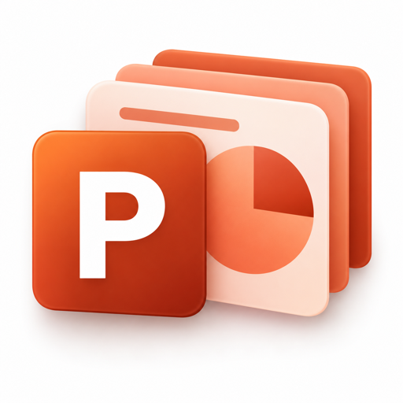

# Office 系列视觉预览

三款办公专家采用熟悉的颜色与字母识别：Word 蓝色 W、Excel 绿色 X、PPT 橙色 P；文档、表格网格与图表分别强化功能识别。图片为本项目生成的发布素材。

| Word文档专家 | Excel文档专家 | PPT制作与美化专家 |
|---|---|---|
|  |  |  |

本页展示的是头像素材与预览。Word 与 Excel 的免费版本已提交审核；PPT云端版也已提交审核。三项均未确认上架，上传预览成功本身不代表配置已最终保存。

| 产品 | 当前发布策略 | 已有验证 | 当前平台状态 |
|---|---|---|---|
| [Word文档专家](word-listing.md) | 免费核心版，¥0 | WorkBuddy 客户端新建、审阅与清洁副本三份 DOCX，27项检查通过；Microsoft Word 实际打开，核对两页排版与批注回复 | 1.0.0 已提交审核；当前审核中，尚未上架 |
| [Excel文档专家](excel-listing.md) | 免费核心版，¥0 | 最终平层安装版在 WorkBuddy 客户端完成原生读取、局部修改、计算和另存，35项文件检查通过；云端尚未验收 | 1.0.0 已连同头像、分类与完整介绍提交审核；当前审核中，尚未上架 |
| [PPT制作与美化专家](ppt-cloud-listing.md) | 自有云免费核心版，¥0 | WorkBuddy实际HTTPS新建、导入、指定页修改与下载，三页预览已查看，16个未改组件一致 | 1.1.0轻量技能及PPT专家均已提交审核，尚未上架 |

Word、Excel与PPT保持现有免费定位。本轮不新增Pro，原有四款收费技能沿用原价格、原内容与审核。

客户端、本地检查、云端执行、草稿、审核与正式上架是不同状态。以上为当前准备进度；正式价格与权益以未来实际发布的页面为准。

[返回产品目录](README.md)

Excel与Word专家保持审核中；财务、供应商、项目、数据四款免费专家正在同名收紧范围，旧包已撤回，修订包尚未上架。头像保留，完整收费内核不再附送。详细入口及状态见[专家列表](EXPERTS.md)。
